# JK Color Gradient

指定した色のグループ（最大32色）の中で、色と色の境界をグラデーションにし、
しきい値マップ（網点・線・ディザ・ノイズ・任意レイヤー）で質感をつける After Effects プラグインです。

ディスプレイスメントで歪ませる方式とは違い、各色の領域までの距離を求めておき、
各ピクセルでは「テクスチャの値 < 色の割合」を比べるだけなので軽く動きます。

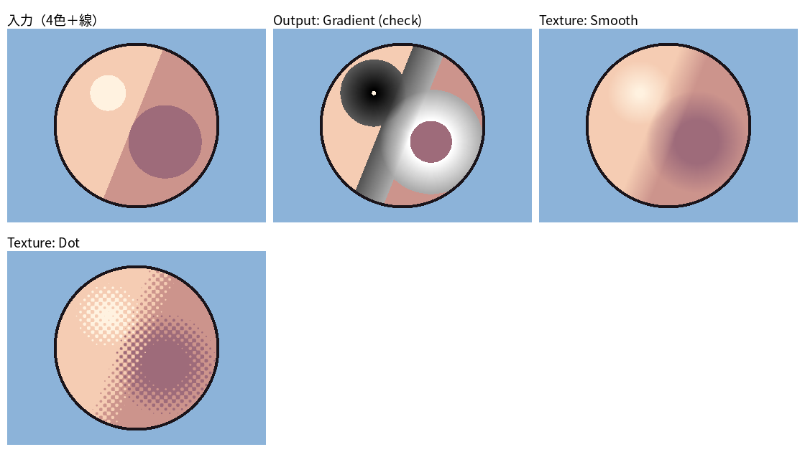

## 仕組み

1. **ラベル付け**：各ピクセルがグループ内の何番目の色か（グループ外の色や Alpha Threshold 未満のピクセルは対象外）
2. **色ごとの距離変換**：その色の領域までの距離を、領域の周り（グラデーションが届く範囲）だけ求める
3. **重み**：符号付き距離 s（領域の内側で負）にバイアス（Grow・Offset・荒らし）を足し、
   `w = clamp(0.5 - s / (Width × Spread))` を色ごとに作って合計が1になるよう正規化
   - どの色の重みも位置だけで決まる（自分が何色かに依存しない）ので、3色以上が接する点でも継ぎ目が出ない
4. **しきい値処理**：並び順の大きい色から重みを積み上げ、テクスチャの値 t が入った区間の色にする
   （2色なら「t < 上側の色の割合」で上側の色。3色以上では網点が入れ子になる）

グラデーションの範囲外のピクセルは入力をそのまま出力します（8bitの丸め直しもしません）。

## パラメータ

### 色の判定

| 名前 | 内容 |
|---|---|
| Tolerance | 全色共通の許容差（0〜255、チャンネルごとの最大差） |
| Alpha Threshold | これ以上のアルファのピクセルだけを対象にする（初期値255 = 不透明のみ） |
| Use n / Color n | 使う色にチェックを入れて色を指定（2色以上）。8色ずつ折りたたみ |
| Tolerance n | その色だけの許容差（全体の Tolerance に足す） |
| Spread n | その色がにじむ幅の倍率。大きいほど隣の色の領域へ深く入り込む |
| Grow n | その色の領域を広げる量（px）。マイナスで狭める |

**色の番号の順番がグラデーションの向きを決めます。** ハイライト → ベース → 影 → 2影 のように明るい順に並べると、
どの境界でも網点の積み上げ方が揃います。

Tolerance を上げすぎると、線のアンチエイリアス部分まで近い色として拾われます（下のサンプル参照）。

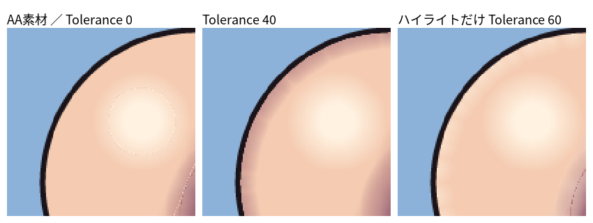

### Gradient

| 名前 | 内容 |
|---|---|
| Width | グラデーション全体の幅（px）。境界の両側に半分ずつ |
| Offset | 境界の位置ずらし（px）。＋で番号の大きい色の側へ（番号が k 離れた色どうしでは k 倍ずれる） |
| Reverse Order | 並び順を逆にする（網点の積み上げ順・Offset の向きが反転） |
| Curve | Linear / Smooth |
| Curve Power | 1 でそのまま。大きいほど境界付近が急に、小さいほど端まで残る |
| Max Mix Colors | 1ピクセルが混ぜる近くの色の数（1〜6）。少ないと3色の接合部に継ぎ目が出る |
| Mid Color / Mid Amount | 色が混ざっているところに乗せる色と強さ（2色の境界の真ん中で最大） |

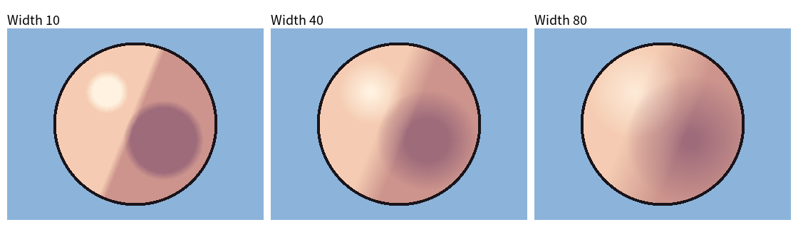
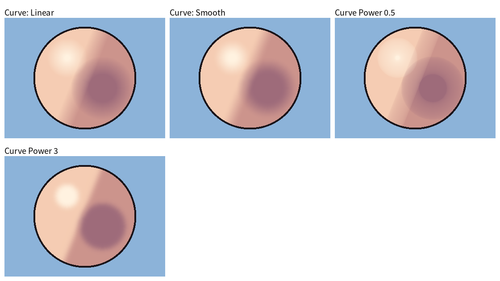
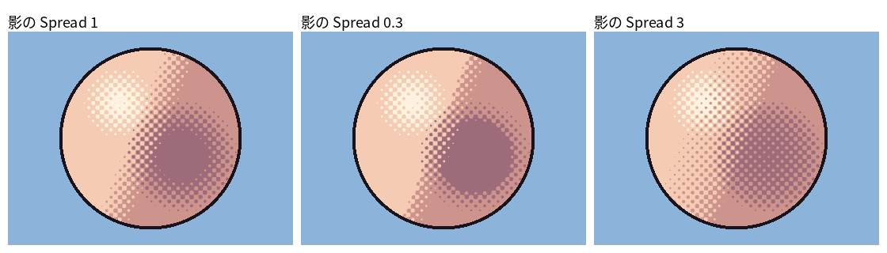
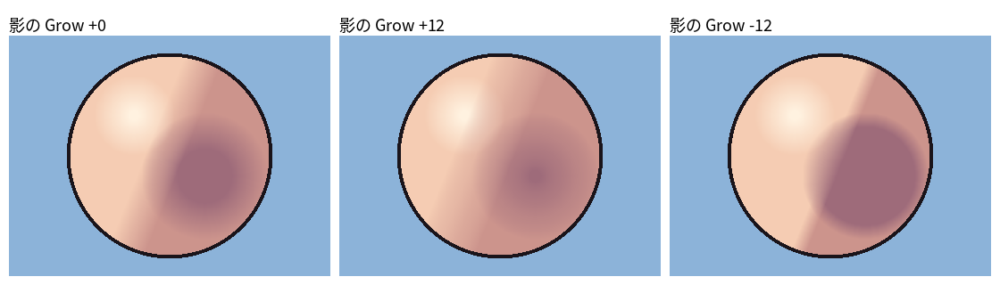
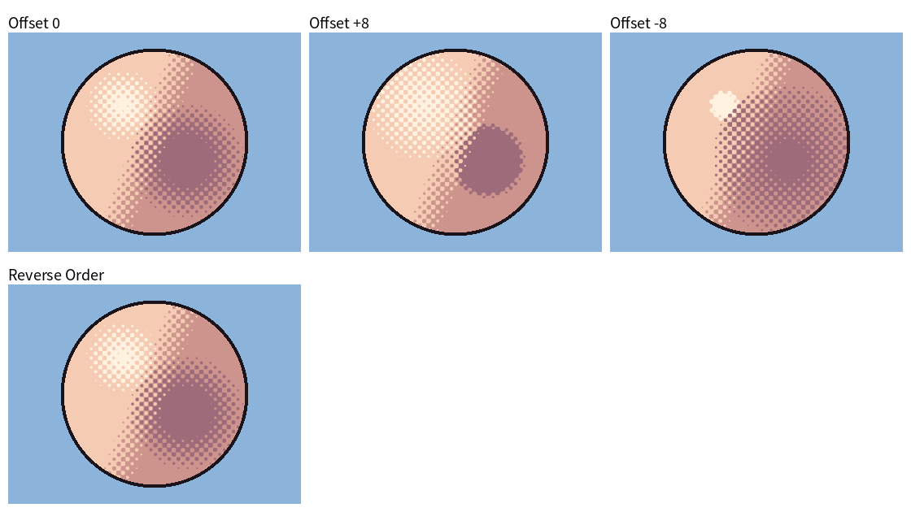
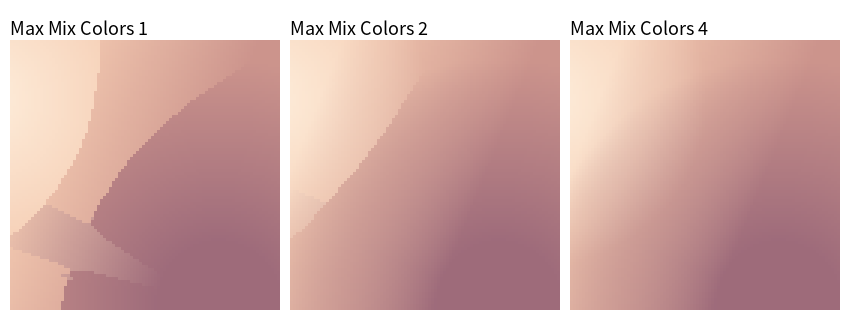
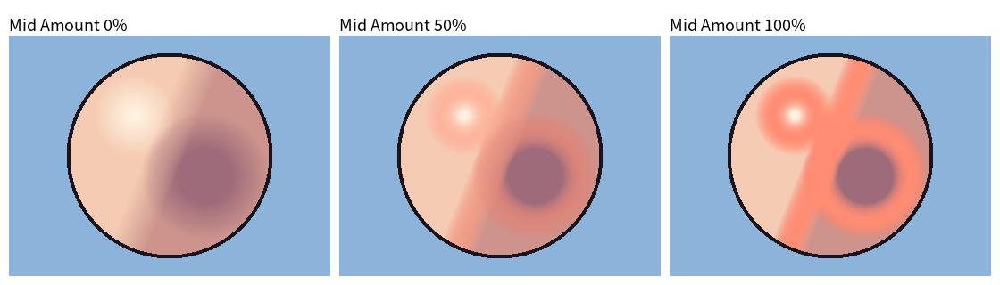

### Texture

| 名前 | 内容 |
|---|---|
| Texture | Smooth / Dot / Line / Bayer / Grain / Noise / Layer |
| Amount | テクスチャの効き（0% でなめらかなグラデーション） |
| Cell Size | 網点・線の周期、ノイズの粒の大きさ（px） |
| Angle | 角度（Layer 以外のすべて） |
| Offset X / Y | テクスチャの位置ずらし（px） |
| Dot Shape | Round / Circle / Ellipse / Square / Diamond。どの形でも面積率が色の割合と一致するよう補正済み |
| Ellipse Aspect | 楕円の縦横比 |
| Dither Size | Bayer・Grain の1粒の大きさ（px） |
| Noise Detail / Noise Contrast | ノイズの細かさの重ね数（1〜6）とコントラスト |
| Texture Layer | Layer で使うレイヤー（タイル状に繰り返す） |
| Layer Channel | Luminance / Alpha / Red / Green / Blue |
| Layer Scale | レイヤーの拡大率 |
| Layer Black / White | レベル補正（この範囲を 0〜1 に引き伸ばす） |
| Invert / Seed | |
| Antialias | Off / 2x2 / 4x4 / 8x8（サブピクセルのサンプル数） |

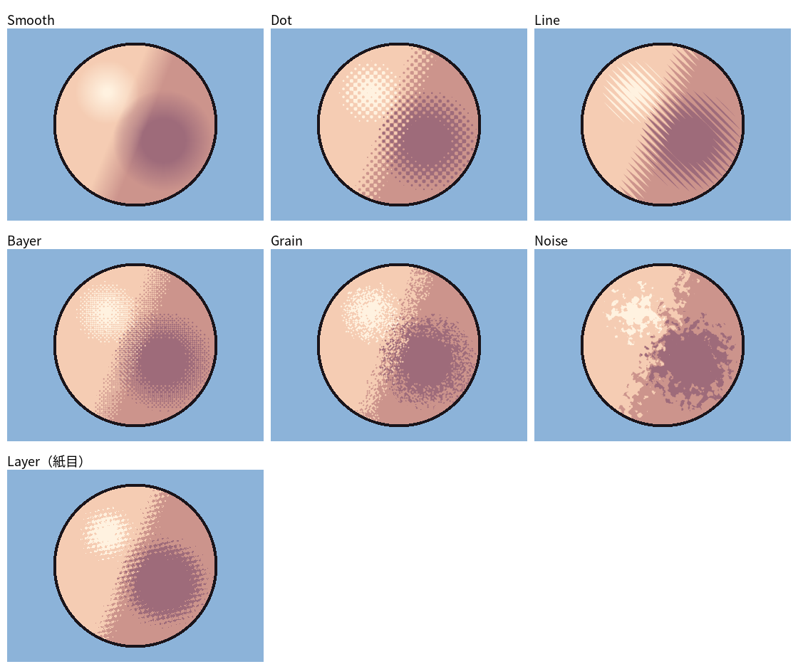
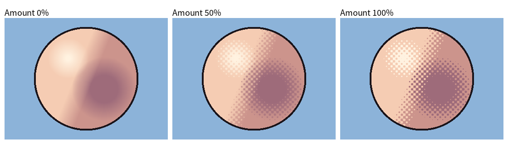
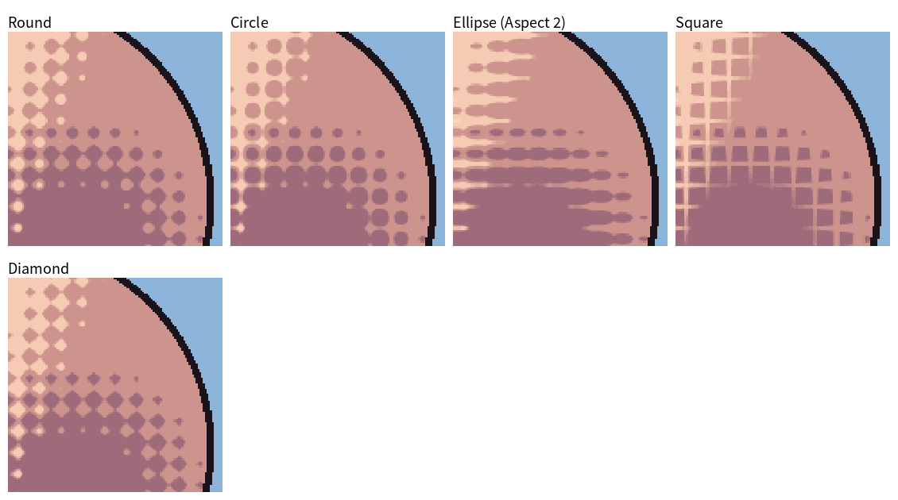
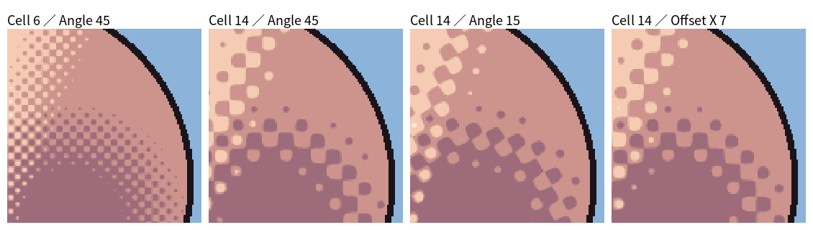
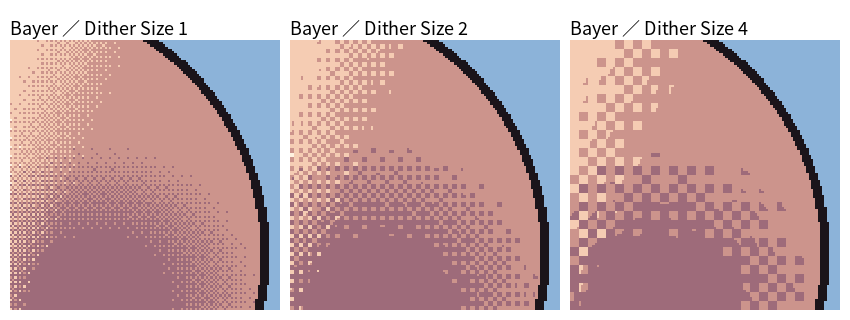
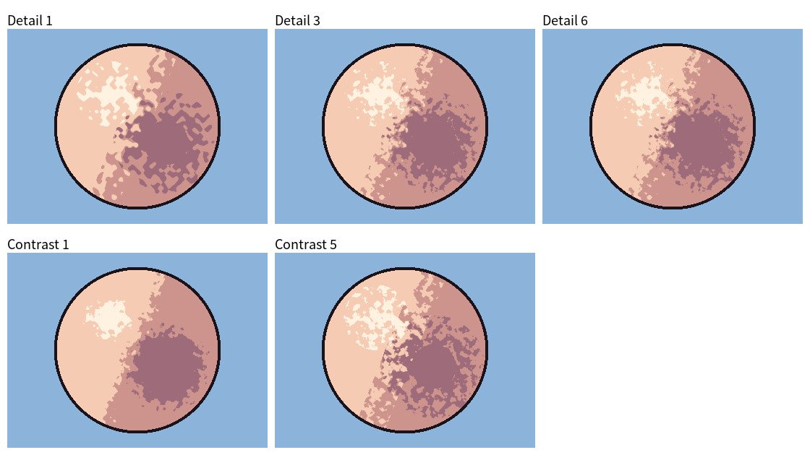
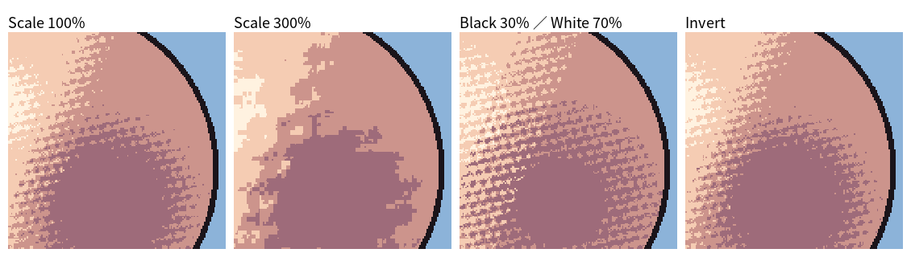
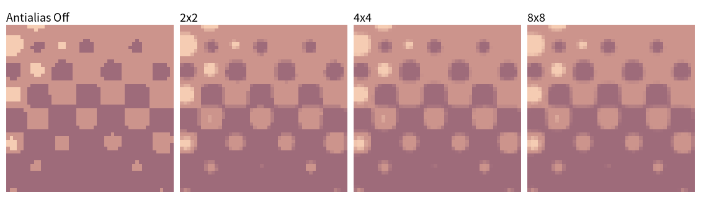

### Roughness・その他

| 名前 | 内容 |
|---|---|
| Roughness Amount / Scale / Seed | 色ごとに別のノイズで境界の位置をずらして荒らす（旧ディスプレイスメント相当） |
| Animate Seed | フレームごとに Seed を変える（砂目・ノイズ・荒らしが毎フレーム変わる） |
| Output | Result / Gradient (check)：テクスチャ前の色の並び（番号の重み付き平均）をグレーで確認 |

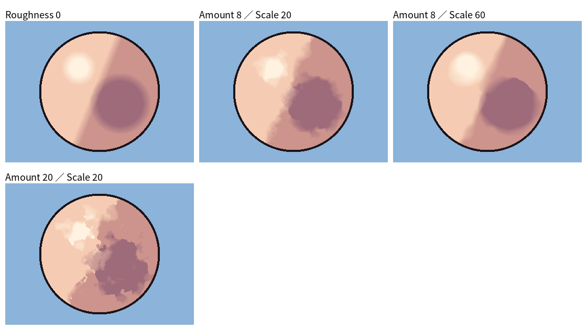

## ビルド

```sh
cd colorgradient
just release     # または cargo jk install
```

AE非対応のOS（Linuxなど）では `after-effects` を参照しないので、コアのテストだけ行えます。

```sh
cargo test --lib
# サンプル画像の作り直し
cargo run --release --example samples -- samples_out
python3 tools/make_sheets.py samples_out docs/samples
```

## 既知の制限・TODO

- グループ外の色（線など）を挟んでいても、Width の範囲内に別のグループ色があればグラデーションがかかる（線のピクセル自体は変えない）
- Grow・Offset を入れると、境界の位置に合わせてグラデーションの幅も少し変わる
- 使わない色スロットの非表示（ダイナミックストリームフラグ）は未実装。8色ごとの折りたたみで代用
- Premiere Pro では BGRA の並びに未対応（AE専用として扱う）
- 距離場のキャッシュは未実装（テクスチャだけ変えたときも毎回再計算。色ごとに距離変換するので、色数と領域の大きさに比例して重くなる。4色・1920×1080・2スレッドで約120ms）
- テクスチャ座標にワールドの `origin` を使っている。プレビューの部分描画でパターンがずれる場合は符号を確認する
