# JK Tone Gradient

指定した色のグループ（最大32色）の中で、色と色の境界をグラデーションにし、
しきい値マップ（網点・線・ディザ・ノイズ・任意レイヤー）で質感をつける After Effects プラグインです。

ディスプレイスメントで歪ませる方式とは違い、各色の領域までの距離を求めておき、
各ピクセルでは「テクスチャの値 < 色の割合」を比べるだけなので軽く動きます。

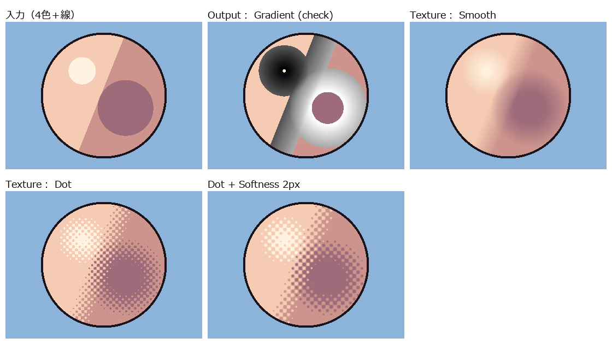

## 仕組み

1. **ラベル付け**：各ピクセルがグループ内の何番目の色か（グループ外の色や Alpha Threshold 未満のピクセルは対象外）
2. **色ごとの距離変換**：その色の領域までの距離を、領域の周り（グラデーションが届く範囲）だけ求める
3. **重み**：符号付き距離 s（領域の内側で負）にバイアス（Grow・Offset・荒らし）を足し、
   `w = clamp(0.5 - s / (Width × Spread))` を色ごとに作って合計が1になるよう正規化
   - どの色の重みも位置だけで決まる（自分が何色かに依存しない）ので、3色以上が接する点でも継ぎ目が出ない
4. **しきい値処理**：並び順の大きい色から重みを積み上げ、テクスチャの値 t が入った区間の色にする
   （2色なら「t < 上側の色の割合」で上側の色。3色以上では網点が入れ子になる）

グラデーションの範囲外のピクセルは入力をそのまま出力します（8bitの丸め直しもしません）。

## パラメータ

パラメータは、よく使う全体の設定を一番上に置き、残りをグループに分けています。
使っていない項目（オフの色スロット、選んだテクスチャに関係ない項目、オフのグループの項目）はグレーアウトします。

### 全体（一番上）

| 名前 | 内容 |
|---|---|
| Output | Result / Gradient (check)：テクスチャ前の色の並び（番号の重み付き平均）をグレーで確認 |
| Width | グラデーション全体の幅（px）。境界の両側に半分ずつ |
| Texture | Smooth / Dot / Line / Bayer / Grain / Noise / Layer |
| Texture Layer | Texture が Layer のときに使うレイヤー（レイヤー全体を1枚としてタイル状に繰り返す） |
| Texture Mode | Threshold（初期値）：テクスチャの値と色の割合を比べて色を選ぶ（網点のように2色に分かれる）／ Map：テクスチャの濃淡で混ざり具合を連続的にずらす（2値にならない。Amount が強さ。平均の色の割合と両端は変わらない） |
| Amount | テクスチャの効き（0% でなめらかなグラデーション） |
| Draft | Off / When Layer Quality is Draft / Always。アンチエイリアスを省いて軽くする。初期値はレイヤーの画質スイッチが「ドラフト」のときだけ（レンダーキューの「最高画質」では効かない） |
| Animate Seed | フレームごとに Seed を変える（砂目・ノイズ・荒らしが毎フレーム変わる） |

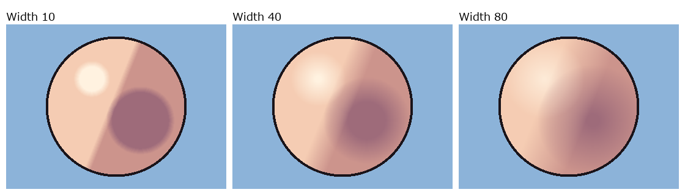

### Color Select

| 名前 | 内容 |
|---|---|
| Tolerance | 全色共通の許容差（0〜255、チャンネルごとの最大差） |
| Alpha Threshold | これ以上のアルファのピクセルだけを対象にする（初期値255 = 不透明のみ） |
| Use n / Color n | 使う色にチェックを入れて色を指定（2色以上）。8色ずつ折りたたみ |
| Color n Detail ＞ Tolerance n | その色だけの許容差（全体の Tolerance に足す） |
| Color n Detail ＞ Spread n | その色がにじむ幅の倍率。大きいほど隣の色の領域へ深く入り込む |
| Color n Detail ＞ Grow n | その色の領域を広げる量（px）。マイナスで狭める |

**色の番号の順番がグラデーションの向きを決めます。** ハイライト → ベース → 影 → 2影 のように明るい順に並べると、
どの境界でも網点の積み上げ方が揃います。

Tolerance を上げすぎると、線のアンチエイリアス部分まで近い色として拾われます（下のサンプル参照）。

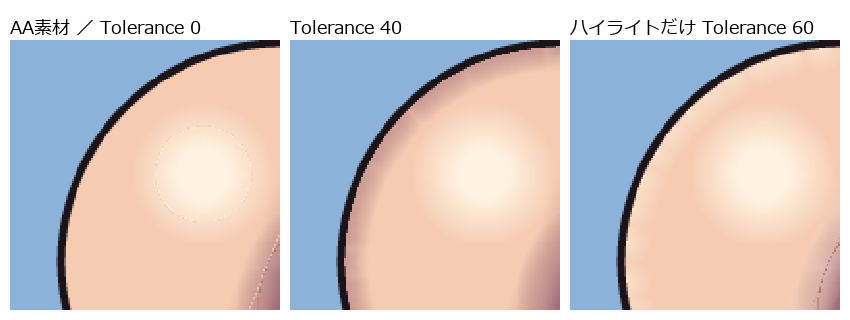
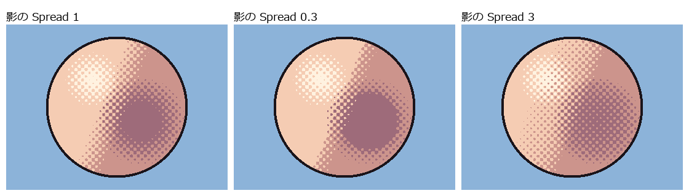
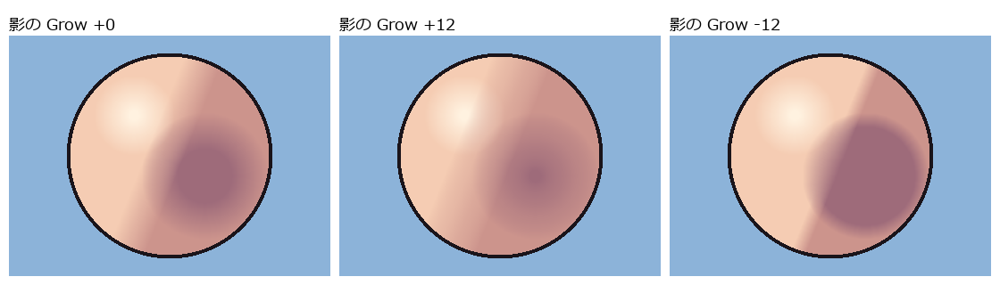

### Gradient

| 名前 | 内容 |
|---|---|
| Offset | 境界の位置ずらし（px）。＋で番号の大きい色の側へ（番号が k 離れた色どうしでは k 倍ずれる） |
| Reverse Order | 並び順を逆にする（網点の積み上げ順・Offset の向きが反転） |
| Curve | Linear / Smooth / Custom |
| Curve Graph | Curve が Custom のときに使うカーブのグラフ。クリックで点を追加（近くに点があればつかむ）、ドラッグで動かし、グラフの外までドラッグして離すと消える。両端 (0,0)・(1,1) は固定で、点の間は行き過ぎない単調な曲線でつなぐ（点は最大8個）。キーフレームも打てる（点の数が同じならなめらかに変わる） |
| Curve Power | 1 でそのまま。大きいほど境界付近が急に、小さいほど端まで残る（Custom のときは使わない） |
| Max Mix Colors | 1ピクセルが混ぜる近くの色の数（1〜6）。少ないと3色の接合部に継ぎ目が出る |

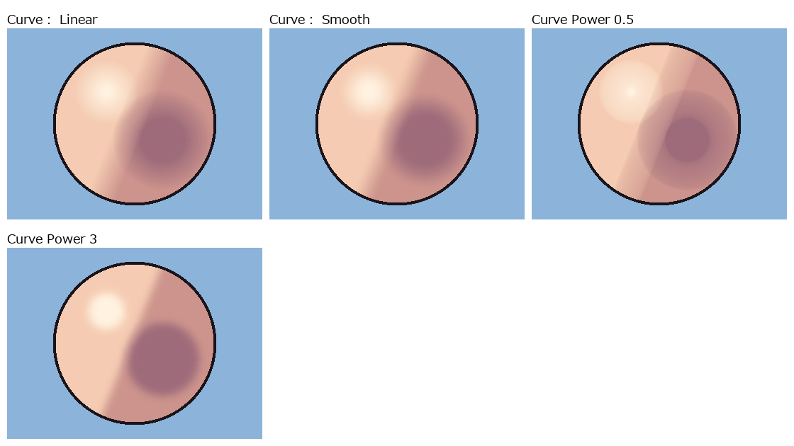
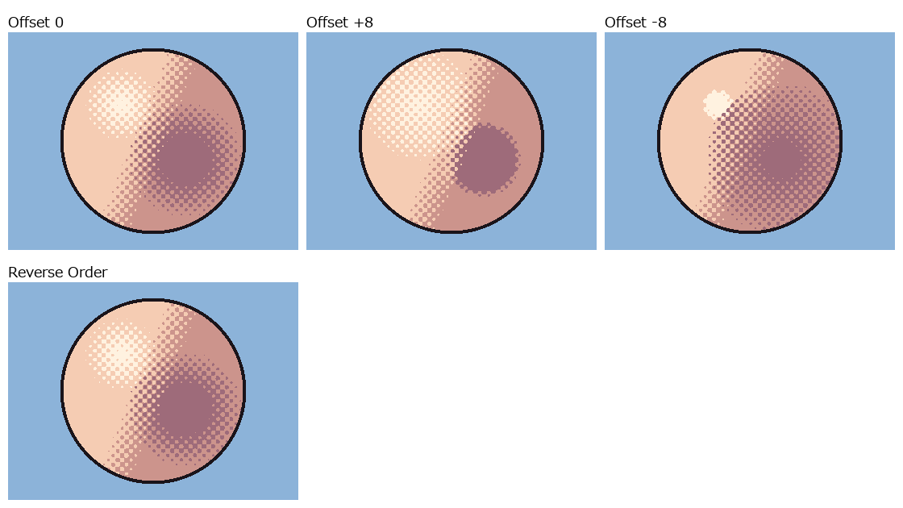
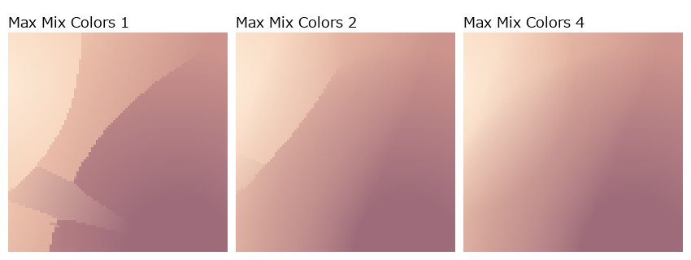

### Mid Color

| 名前 | 内容 |
|---|---|
| Enable Mid Color | オフのときは計算しない |
| Mid Color / Mid Amount | 色が混ざっているところに入れる3つ目の色と、その量（2色の境界の真ん中で最大）。上から重ねるのではなく、グラデーションの途中の色として扱うので、テクスチャ・Softness も同じようにかかる |
| Mid Width | 中間色の帯の太さ。100% で混ざっているところ全体、小さいほど境界の真ん中に寄る（初期値 50%） |
| Mid Position | Core（網点の中心に中間色の網点として出る、初期値）／ Rim（網点のふちに輪のように出る） |

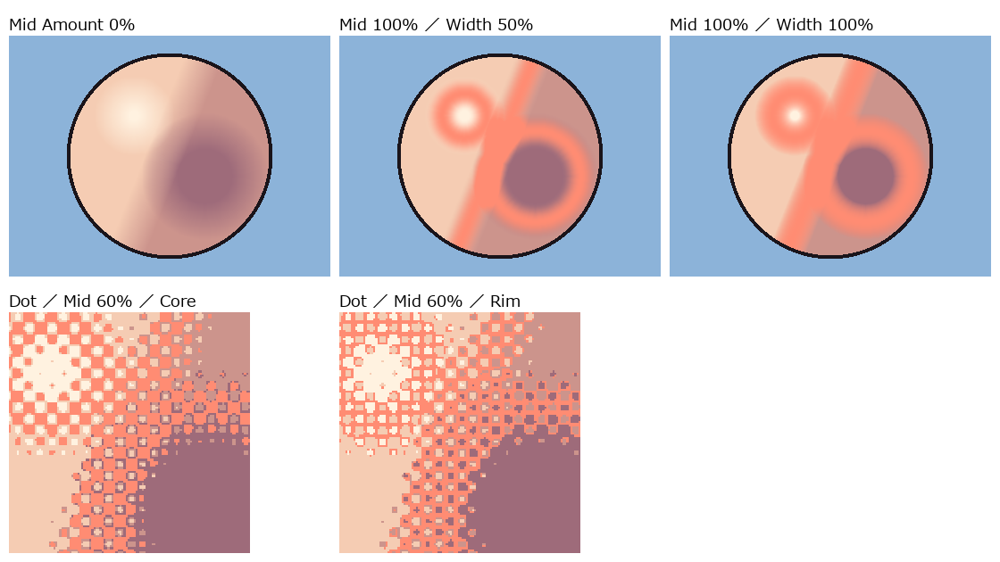

### Texture Settings

| 名前 | 内容 |
|---|---|
| Enable Texture | オフのときは Smooth と同じ（テクスチャを計算しない） |
| Softness | 網点や粒のふちをぼかす幅（px、Threshold のとき）。0 でくっきり。その場所でのテクスチャの変化に合わせて、ふちだけを指定の幅でなめらかにする（網点の中と外の色は変わらない）。どの値でも色の割合は変わらない |
| Cell Size | 網点・線の周期、ノイズの粒の大きさ（px）。Dot / Line / Noise |
| Angle | 角度（Dot / Line / Noise。Bayer・Grain は細かい粒を回すとモアレが出るので回転しない） |
| Offset X / Y | テクスチャの位置ずらし（px） |
| Dot Shape | Round / Circle / Ellipse / Square / Diamond。どの形でも面積率が色の割合と一致するよう補正済み |
| Ellipse Aspect | 楕円の縦横比（Dot Shape が Ellipse のとき） |
| Dither Size | Bayer・Grain の1粒の大きさ（px） |
| Noise Detail / Noise Contrast | ノイズの細かさの重ね数（1〜6）とコントラスト |
| Layer Channel | Luminance / Alpha / Red / Green / Blue |
| Layer Scale | レイヤーの拡大率（バイリニア補間） |
| Layer Black / White | レベル補正（この範囲を 0〜1 に引き伸ばす） |
| Invert / Seed | Seed は Grain・Noise |
| Antialias | Off（初期値）/ 2x2 / 4x4 / 8x8（サブピクセルのサンプル数。Draft のときは Off） |

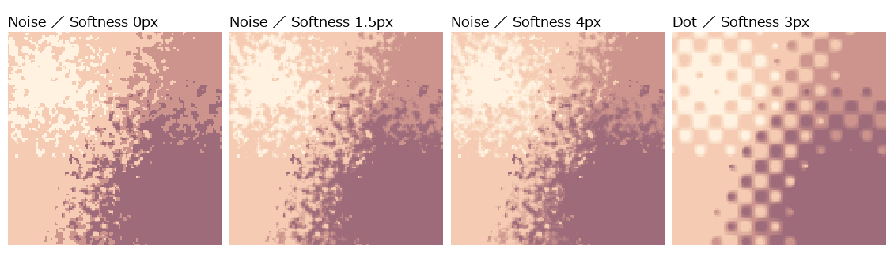
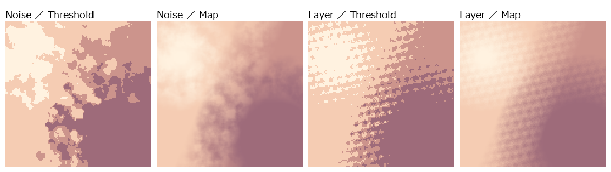
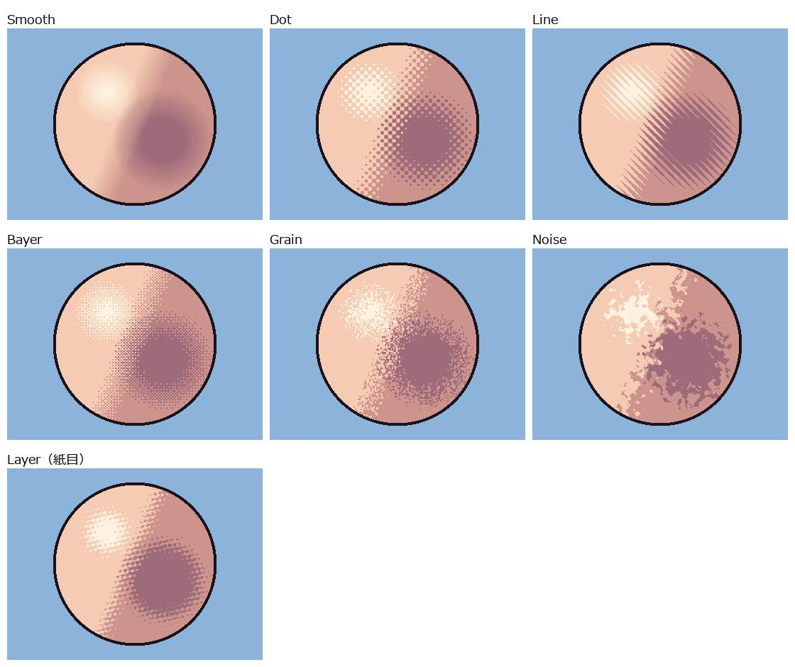
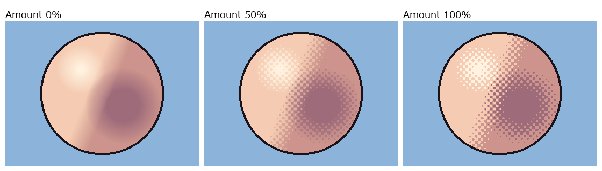
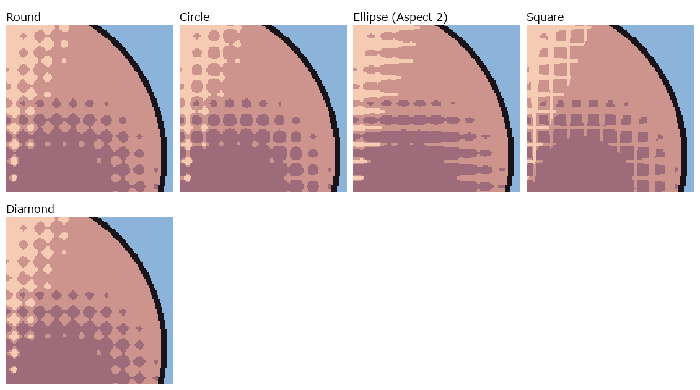
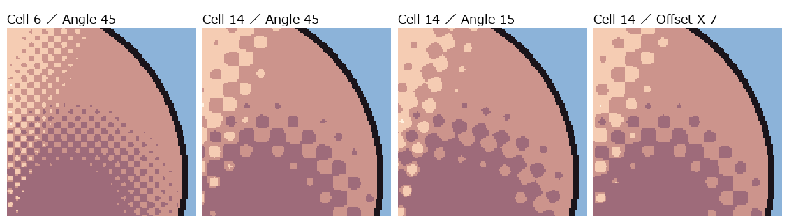
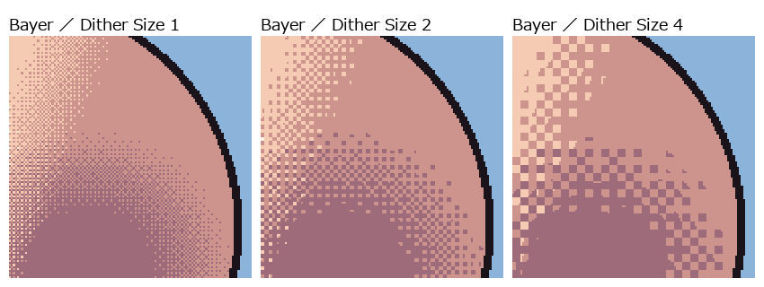
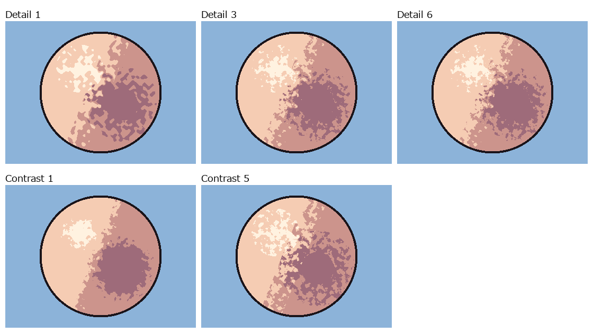
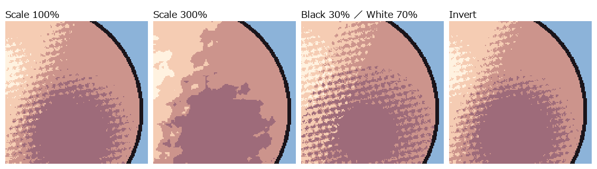
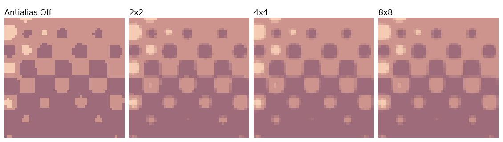

### Roughness

| 名前 | 内容 |
|---|---|
| Enable Roughness | オフのときは計算しない |
| Rough Amount / Scale / Seed | 色ごとに別のノイズで境界の位置をずらして荒らす（旧ディスプレイスメント相当） |

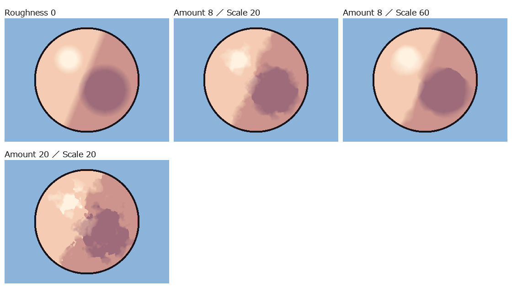

## ビルド

```sh
cd tonegradient
just release     # または cargo jk install
```

AE非対応のOS（Linuxなど）では `after-effects` を参照しないので、コアのテストだけ行えます。

```sh
cargo test --lib
# サンプル画像の作り直し
cargo run --release --example samples -- samples_out
python3 tools/make_sheets.py samples_out docs/samples
# 処理時間の目安
cargo run --release --example bench -- 60
```

### AE を使わない確認（AEXCompat）

[AEXCompat](https://github.com/onmokoworks/AEXCompat) の `broker render-video-batch` を使うと、
ビルドした `.aex` を AE に入れずに（管理者権限なしで）SmartFX として描画できます。
JK Tone Gradient は SmartFX 専用なので `"smart": true` が必要です。

```json
{
  "schema_version": 1,
  "plugin": "C:/path/to/tonegradient.aex",
  "input_frames": ["C:/path/to/input.png"],
  "output_directory": "C:/path/to/out",
  "smart": true,
  "pixel_format": "argb8",
  "parameters": [
    {"slot": 3, "name": "Texture", "kind": "popup", "value": 6, "minimum": 1, "maximum": 7,
     "choices": [], "color": [0,0,0,0], "components": [0,0,0], "component_count": 0,
     "layer_path": null, "enabled": true, "visible": true, "supervised": false}
  ]
}
```

- `slot` はエフェクトコントロールの上からの番号（グループの開始・終了も1つずつ数える）。
  例：Output 1、Width 2、Texture 3、Texture Layer 4、Amount 5
- チェックボックスは `"kind": "integer"`（0 / 1）、スライダーは `"float"`、ポップアップは `"popup"`（1 始まり）
- レイヤーは `"kind": "layer"` と `"layer_path"` に PNG を指定する
- `pixel_format` は `argb8` / `argb16` / `argb32f`

決まった設定（初期値、Noise＋Softness、Mid Color、Texture Layer）をまとめて描画して
1枚のシートにするスクリプトもあります。

```sh
python tools/aexcompat_check.py <AEXCompat のリポジトリ> <tonegradient.aex> <出力フォルダ> [argb8|argb16|argb32f]
```

## 既知の制限・TODO

- グループ外の色（線など）を挟んでいても、Width の範囲内に別のグループ色があればグラデーションがかかる（線のピクセル自体は変えない）
- Grow・Offset を入れると、境界の位置に合わせてグラデーションの幅も少し変わる
- 距離変換の結果はキャッシュしている（入力と、色の判定・届く距離・Max Mix Colors が同じなら再利用）。
  テクスチャ・Amount・Curve・Mid Color などだけを変えたときは距離変換を飛ばす。
  4色・1920×1080・Width 60 の目安（20スレッドの環境）：準備（ラベル付け・距離変換）約30ms、
  色の合成 約9〜17ms（Antialias 4x4 では約45〜60ms）。キャッシュが当たると準備を飛ばす。
  `cargo run --release --example bench -- <Width>` で測れる
- `Use n` がオフのスロットの項目はグレーアウトする
- パラメータの並びを v0.0.1 から変えたので、v0.0.1 で作ったプロジェクトの設定は引き継げない
- Premiere Pro では BGRA の並びを読み書きする（動作は未確認）
- テクスチャ座標にワールドの `origin` を使っている。プレビューの部分描画でパターンがずれる場合は符号を確認する
